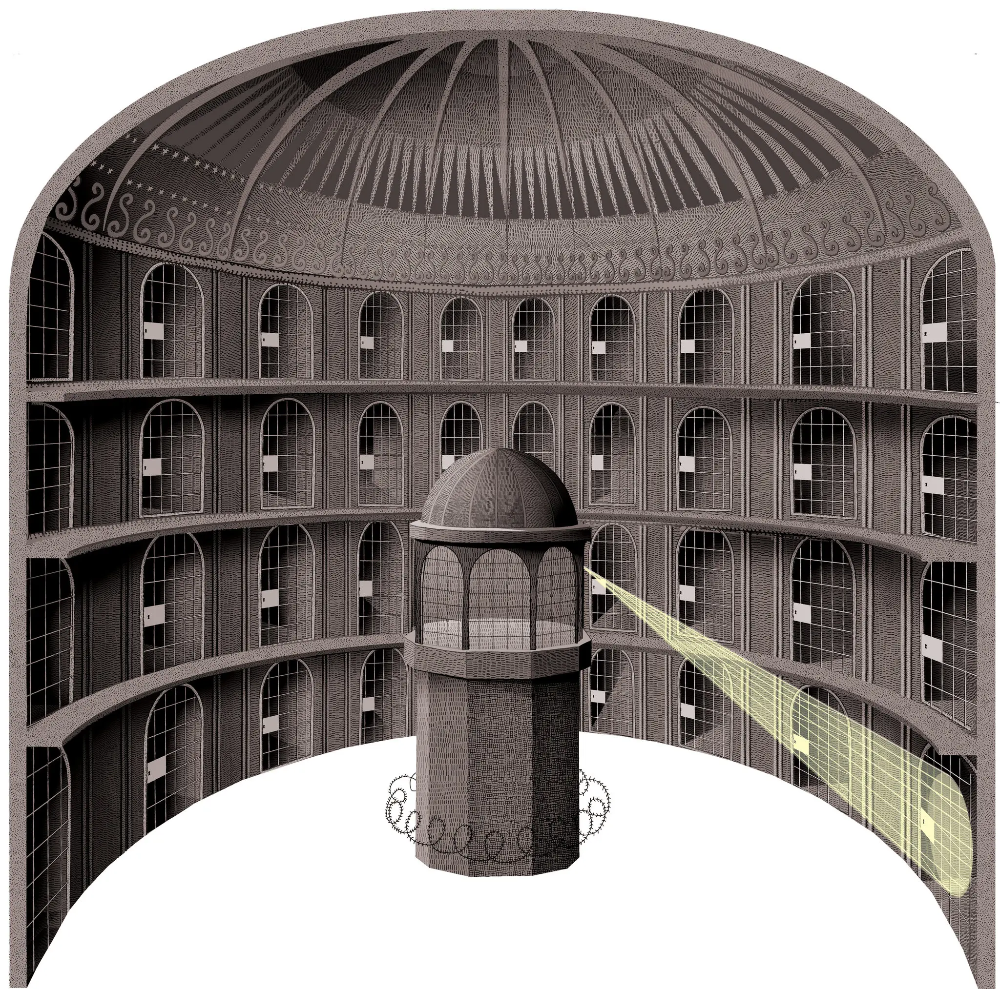
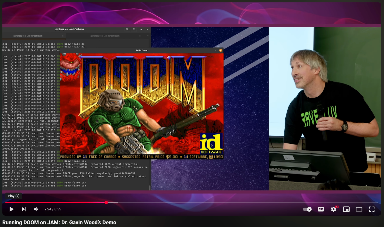
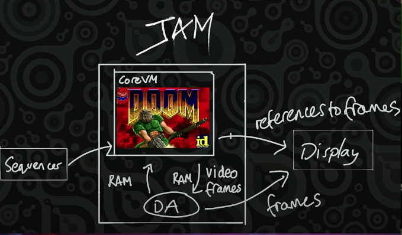

<!-- .slide: data-background-image="../../assets/img/0-Shared/bg/PBA_Background.png" data-background-size="cover" -->

# La arquitectura de blockchains modernas

Francisco Aguirre, UTN Setiembre 2026

---

---

<!-- .slide: data-background-color="#000000" -->

# Capítulo 1

## Blockchain

---

---

---

---

---

---

---

---

<!-- .slide: data-background-color="#000000" -->

# Capítulo 2

## Generalizar

---

<!-- .slide: data-background-color="#000000" -->

## Ethereum

---

---

---

---

---

---

<!-- .slide: data-background-color="#000000" -->

# Capítulo 3

## Modularizar

---

<!-- .slide: data-background-color="#000000" -->

## Substrate

---

---

---

---

---

---

---

<!-- .slide: data-background-color="#000000" -->

## FRAME

---

---

---

---

---

---

---

---

---

---

---

---

---

---

<!-- .slide: data-background-color="#000000" -->

## DEMO

---

<!-- .slide: data-background-color="#000000" -->

## ¿Preguntas hasta acá?

---

<!-- .slide: data-background-color="#000000" -->

# Capítulo 4

## Escalar

---

---

---

---

---

---

---

<!-- .slide: data-background-color="#000000" -->

## ELVES

---

---

---

---

---

---

---

<!-- .slide: data-background-color="#000000" -->

## 1. Collation

---

---

---

---

---

---

---

<!-- .slide: data-background-color="#000000" -->

## 2. Backing

---

---

---

<!-- .slide: data-background-color="#000000" -->

## 3. Data availability

---

---

<!-- .slide: data-background-color="#000000" -->

## 4. Approval checking

---

---

---

---

<!-- .slide: data-background-color="#000000" -->

## 5. Disputes

---

---

---

<!-- .slide: data-background-color="#000000" -->

## DEMO

---

<!-- .slide: data-background-color="#000000" -->

## ¿Preguntas hasta acá?

---

<!-- .slide: data-background-color="#000000" -->

# Capítulo 5

## Abstraer

---

<!-- .slide: data-background-color="#000000" -->

## JAM

---

  
  →
  

---

---

---

---

---

---

https://www.youtube.com/watch?v=hJcw5FMSjQs

---

---

---

---

---

---

---

---

<!-- .slide: data-background-color="#000000" -->

## ¿Preguntas?

---

<!-- .slide: data-background-color="#000000" -->

## Gracias
