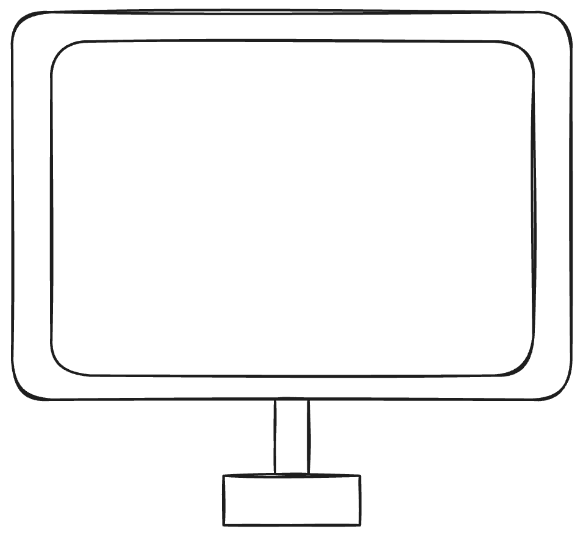
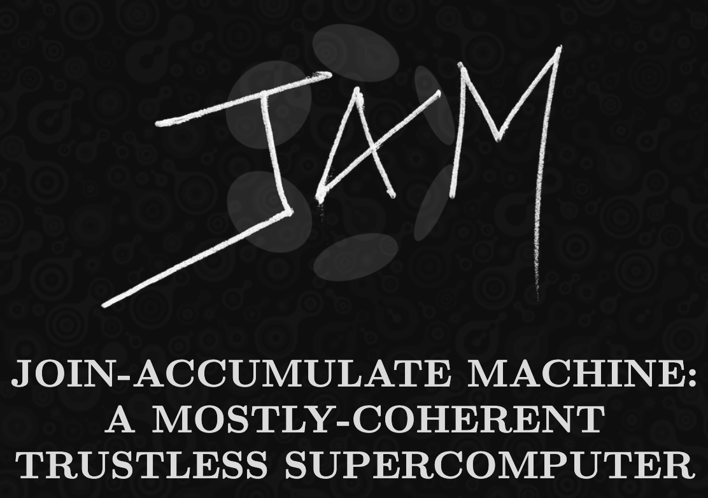

<!-- .slide: data-background-image="../../assets/img/0-Shared/bg/PBA_Background.png" data-background-size="cover" -->

# La arquitectura de blockchains modernas

Francisco Aguirre, UTN Setiembre 2026

Notes:

Desarrollador en Parity Technologies.
Ingeniero en computación de la UdelaR de Montevideo, Uruguay.
Ex alumno de la primera PBA en Cambridge 2022.

---v

Notes:

Vamos a empezar desde lo más básico, qué es una blockchain, generalizar, modularizar, escalar y abstraer para obtener arquitecturas cada vez más complejas.

---

<!-- .slide: data-background-color="#000000" -->

# Capítulo 1

## Blockchain

Notes:

Así que empezamos por el comienzo: vamos a repasar qué es una blockchain.

---v

### Estructura de datos

Notes:

Una blockchain es una estructura de datos muy simple en la que los bloques tienen una serie de operaciones (o transacciones) y cada bloque referencia al anterior mediante su hash.
No es una linea recta sino que presenta forks.

---v

<h3 style="margin-top: 150px; margin-bottom: -225px;">Sistema decentralizado</h3>

  

    
    
  

  ↔
  

    
    
  

  ↔
  

    
    
  

Notes:

Cuando decimos blockchain usualmente no hablamos solo de la estructura de datos sino de un sistema decentralizado.

---v

### Decentralizado ≠ Distribuído

Notes:

Cuando decimos "sistema decentralizado", no nos referimos únicamente a el aspecto distribuído del mismo.
En un sistema distribuído, los nodos pueden todos pertenecer a la misma compañía, haciendolo centralizado.

---v

### Capas

Notes:

Estos sistemas tienen varias capas.
La capa de red es la más baja que suele ser una librería como libp2p.
La capa de consenso es como todas las máquinas de la red deciden quien va a producir el siguiente bloque.
La capa de protocolo es la que define las operaciones que van en los bloques y como se procesan.
La capa de aplicacion permite a los usuarios interactuar con el sistema.

---v

### Maquina de estados

Notes:

Al final del dia, uno de estos sistemas es una maquina de estados replicada en varias maquinas.
Es un ambiente adversarial, en el que todas las maquinas son propiedad de distintos individuos y empresas.
En el corazon de todo eso, en la capa de protocolo, esta la funcion de transicion de estado que toma el estado anterior y un bloque y devuelve el nuevo estado.

---v

<!-- .slide: data-background-color="#000000" -->

## Bitcoin

Notes:

Vamos a empezar hablando de Bitcoin dado que es la blockchain mas simple.

---v

### Función de transición de estado

Notes:

La funcion de transicion de estado de Bitcoin es simplemente hacer transferencias de UTXOs.

---v

Notes:

El bloque, de manera simplificada, tiene las transferencias y el header la raiz del merkle tree de todas las transacciones del bloque.

---v

Notes:

Estas son las implementaciones de cada capa en Bitcoin.

---v

Notes:

Podemos permitir que los usuarios programen esta maquina decentralizada?

---

<!-- .slide: data-background-color="#000000" -->

# Capítulo 2

## Generalizar

---v

<!-- .slide: data-background-color="#000000" -->

## Ethereum

Notes:

Vamos a hablar de Ethereum, EVM y Smart Contracts, que generalizan la STF y la hacen mucho mas util.

---v

---v

---v

---v

---v

---

<!-- .slide: data-background-color="#000000" -->

# Capítulo 3

## Modularizar

---v

<!-- .slide: data-background-color="#000000" -->

## Substrate

---v

---v

---v

---v

---v

---v

---v

---v

<!-- .slide: data-background-color="#000000" -->

## FRAME

---v

---v

---v

---v

---v

## Hooks

---v

## Transaction extensions

---v

---v

---v

---v

---v

---v

---v

<!-- .slide: data-background-color="#000000" -->

## DEMO

---

<!-- .slide: data-background-color="#000000" -->

# Capítulo 4

## Escalar

---v

### Vertical scaling

---v

### Rollups

---v

### Sovereign chains

---v

### Shared security

---v

---v

### Panopticon

---v

<!-- .slide: data-background-color="#000000" -->

## ELVES

---v

---v

---v

---v

---v

---v

---v

<!-- .slide: data-background-color="#000000" -->

## 1. Collation

---v

---v

---v

---v

---v

---v

---v

<!-- .slide: data-background-color="#000000" -->

## 2. Backing

---v

---v

---v

<!-- .slide: data-background-color="#000000" -->

## 3. Data availability

---v

---v

<!-- .slide: data-background-color="#000000" -->

## 4. Approval checking

---v

---v

---v

---v

<!-- .slide: data-background-color="#000000" -->

## 5. Disputes

---v

---v

---v

<!-- .slide: data-background-color="#000000" -->

## DEMO

---

<!-- .slide: data-background-color="#000000" -->

# Capítulo 5

## Abstraer

---v

<!-- .slide: data-background-color="#000000" -->

## JAM

---v

---v

  
  →
  

---v

---v

---v

---v

---v

---v

https://www.youtube.com/watch?v=hJcw5FMSjQs

---v

---v

---v

---v

---v

---v

---v

---v

---v

<!-- .slide: data-background-color="#000000" -->

## ¿Preguntas?

---v

<!-- .slide: data-background-color="#000000" -->

## Gracias
